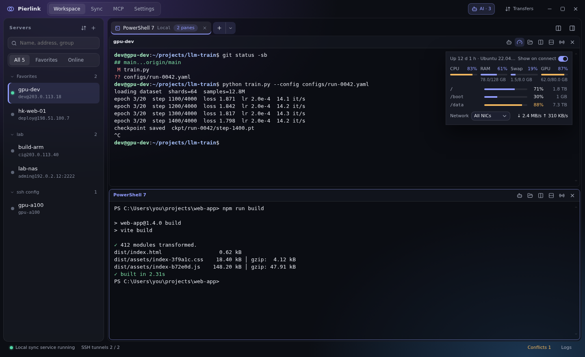
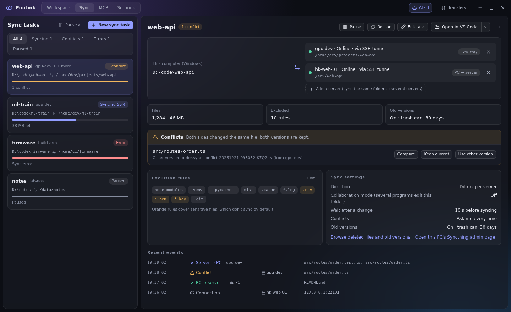
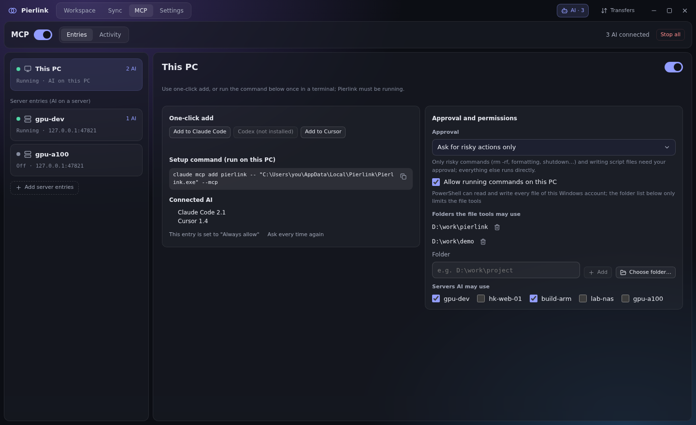
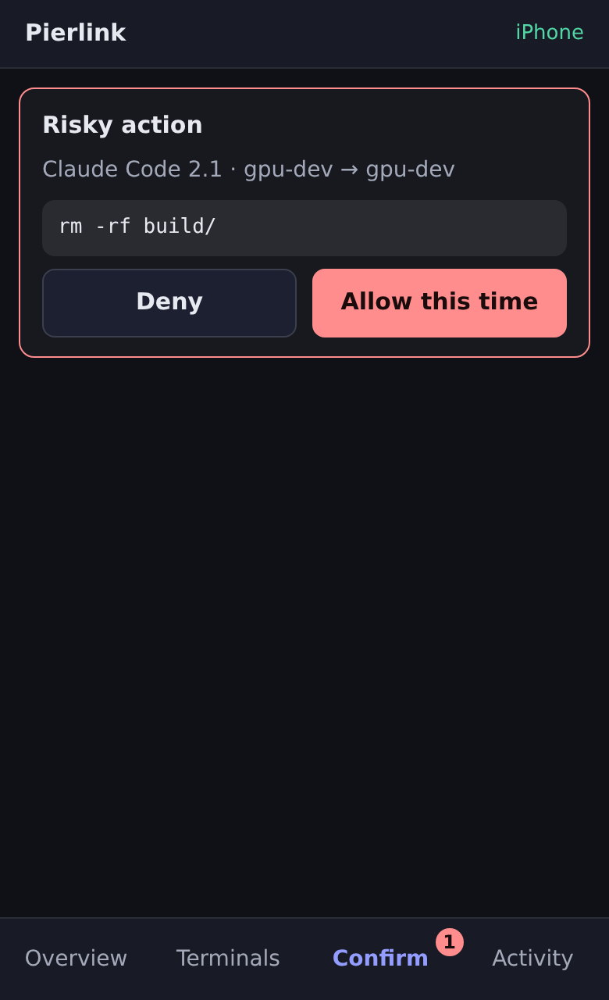

<div align="center">


# Pierlink

**A Windows workbench for remote development across many servers**

Terminals, file sync and AI access for all your servers, in one window.

English · [简体中文](README.md)

[](https://github.com/pierlink/Pierlink/releases/latest)
[](LICENSE)
[](#install)

[Download](https://github.com/pierlink/Pierlink/releases/latest) · [Features](#features) · [Getting started](#getting-started) · [FAQ](#faq) · [License](#license)

</div>



## Why Pierlink

- **Sign in once, use it everywhere**: the built-in SSH signs in once (passwords and verification codes included), and terminals, files, port forwarding, sync and the overview all share that session.
- **Edit locally, run on the server**: server folders and local Windows folders stay in sync both ways. Edit in the editor you already use; the server has the new version right away.
- **AI does the work, you stay in charge**: AI assistants such as Claude Code, Codex and Cursor can work with your terminals and servers; an AI running on a server can edit, build and run on Windows as if it were installed there. It asks before anything risky. Away from your desk? Approve from your phone.

## Features

### Terminals
- Server and local terminals with tabs, split panes and drag-to-rearrange; terminals keep running when you switch pages
- Broadcast input to several panes; command snippets with variables
- Command prediction: as you type in bash or zsh on a server or in local Git Bash, commands you have used appear in gray after the cursor; press → to accept. The history stays on this computer
- Shift+Enter inserts a new line without running it (in shells, Claude Code and Codex); Ctrl+C copies selected text and Ctrl+V pastes; right-click copy and paste can be turned on
- Text copied in Claude Code, vim and similar tools lands in your local clipboard (inside tmux too); links in the terminal open in your Windows browser
- Drag files from File Explorer into a local terminal to insert their paths (written the way PowerShell, Command Prompt or WSL expects)
- Server overview pinned to the terminal: CPU, memory, swap, GPU, disk per mount point, network speed

### Connections
- Built-in SSH (works with servers as old as CentOS 7); or connect with system OpenSSH using `~/.ssh/config`, with one-step import
- Port forwarding: local, remote and SOCKS proxy, restored automatically after disconnects
- File panel: browse, upload, download, rename, delete, and edit text files; drag between panes to transfer files

### File sync
- Built on Syncthing, over SSH tunnels — no open ports, no root needed on the server
- Preview before the first sync; compare both versions of a conflict before choosing; deleted and overwritten files go to old versions and can be restored
- Sync one local folder to several servers at once; open it in VS Code with one click



### AI access (MCP)
- **An AI on a server works as if it were installed on Windows**: no Claude Code on Windows needed. The server-side AI can read, edit by line, and search the Windows folders you allow, and build, run and start background tasks on Windows. File encodings and line endings are kept as they are (GBK, UTF-16, CRLF), and long builds aren't cut off
- The AI can see which folders it may use, which shells exist, and where a synced server path lives on Windows; how to use that is up to the AI
- Hand an open terminal to an AI and take it back any time
- Risky actions (like `rm -rf` or a force push) need your confirmation; choose the approval mode; every step is logged
- One-click setup for Claude Code / Codex / Cursor, and for Claude Code / Codex / Gemini CLI on a server; the title bar shows what the AI just did and its command output



### Server desktop (VNC)
- View a server's VNC desktop in a tab, split next to terminals; over SSH, no ports opened
- Finds existing desktops on the server (TigerVNC and others); enter the password once and remember it
- No desktop on the server? Create one in a click: only you can connect, and it keeps running after you close the tab; TigerVNC is fetched automatically, no admin rights needed
- Quality, scaling, remote resolution that follows the window or a preset, full screen, separate window (optionally by default)
- The clipboard syncs with Windows: text copied on Windows can be pasted in the desktop right away (right-click or Ctrl+V), and text copied in the desktop can be pasted back on Windows

### Phone access


- Away from your PC, answer AI confirmations, check server status and type commands in open terminals from your phone's browser
- Connects to your PC over Tailscale or your LAN — never exposed to the internet, and no Pierlink relay service involved
- Pair with a QR code and approve on the PC; per-phone permissions and names, revocable any time
- Works on iPhone and Android, no app to install

<br clear="right">

### More
- Export servers for others to import in one step; back up your servers and settings and move them to a new PC (sync tasks excluded)
- Lives in the tray, so sync keeps running after you close the window; reconnects after network loss or sleep
- Updates itself; English and Chinese UI

## Install

1. Download `Pierlink_<version>_x64-setup.exe` from [Releases](https://github.com/pierlink/Pierlink/releases/latest).
2. Run the installer, pick English or Chinese, and follow the steps. No administrator rights needed.
3. When a new version is out, a notice appears at the bottom of the window; one click updates.

**Requirements**

| | Requirement |
|---|---|
| PC | Windows 10 / 11, 64-bit |
| Servers (terminals, files, port forwarding) | Any server you can reach over SSH |
| Servers (file sync, server overview) | Linux, x86_64 or ARM64 |
| Phone access | Phone and PC on the same Tailscale network or LAN |

## Getting started

1. **Add a server**: click "+" above the Workspace server list and enter the address and user. Already have `~/.ssh/config`? Use "Import / export servers" next to it.
2. **Open a terminal**: double-click the server. Check the server fingerprint on first connect.
3. **Sync a folder**: Sync → "New sync task", pick a local folder and a server folder, check the preview, then start. The first time, Pierlink walks you through deploying the sync component on the server.
4. **Connect an AI**: on the MCP page turn on the main switch and click "Add to Claude Code" (or Codex, Cursor).
5. **Phone** (optional): Settings → Phone, turn on phone access and scan the QR code with your phone.

## FAQ

<details>
<summary><b>Do I need to install anything on my servers?</b></summary>

Not in advance. Terminals and file transfers only need SSH. The server overview reads system information over the existing SSH connection and installs nothing. On the first sync, Pierlink deploys Syncthing into your home directory — no root, no open ports.

</details>

<details>
<summary><b>Could an AI run something dangerous?</b></summary>

MCP is off by default. Once on, the default mode asks only about risky actions: deleting files, force pushes, shutdowns and similar commands wait for you to allow them; everything else runs directly. You can switch to asking every time. You choose which servers and folders an AI can touch, every action is logged, and "Stop all" is always one click away.

</details>

<details>
<summary><b>Are my passwords and keys safe?</b></summary>

Passwords are saved only when you choose to, in Windows Credential Manager. Private keys never leave your PC. Exported settings files contain no passwords.

</details>

<details>
<summary><b>Does sync keep running after I close the window?</b></summary>

Yes. Closing the window sends Pierlink to the tray, and sync and terminals keep running. Local sync stops only when you quit Pierlink completely, and picks up again next time you open it.

</details>

<details>
<summary><b>Is there a macOS or Linux desktop version?</b></summary>

Not yet — the desktop app runs on Windows 10 / 11. Servers can run any Linux.

</details>

## Privacy and security

- No usage data is collected. Pierlink only contacts GitHub to check for updates, plus the servers you add.
- The sync component listens on this PC only, with global discovery, relays and usage reporting turned off; data travels only through SSH tunnels.
- AI access and phone access are off until you turn them on, and you can revoke them any time.
- Found a security issue? Please report it privately as described in [SECURITY.md](SECURITY.md).

## Build from source

You need Windows, [Node.js](https://nodejs.org/) 24, [Rust](https://rustup.rs/) stable and the Visual Studio C++ build tools (see [Tauri prerequisites](https://tauri.app/start/prerequisites/)):

```powershell
npm ci
node scripts/fetch-bundled.mjs   # downloads the bundled Syncthing and OpenSSH (pinned versions, SHA-256 checked)
node scripts/gen-notices.mjs     # generates the third-party license notices
npx tauri build                  # the installer ends up in target/release/bundle/nsis/
```

## License

Pierlink is released under the [Functional Source License 1.1, Apache 2.0 Future License](LICENSE) (FSL-1.1-ALv2, see [fsl.software](https://fsl.software/)):

- Free for individuals and companies to use, read and modify;
- You may not use it to build a competing commercial product or service;
- Each version becomes Apache 2.0 licensed two years after its release.

Third-party components bundled with the installer are licensed under their own terms; see the `licenses` folder in the install directory.

## Feedback and contributing

- Problems and suggestions: [Issues](https://github.com/pierlink/Pierlink/issues)
- Want to contribute code? Read [CONTRIBUTING.md](CONTRIBUTING.md) first

## Acknowledgements

Pierlink is built on these excellent open source projects: [Tauri](https://github.com/tauri-apps/tauri), [Syncthing](https://github.com/syncthing/syncthing), [russh](https://github.com/Eugeny/russh), [xterm.js](https://github.com/xtermjs/xterm.js), [Win32-OpenSSH](https://github.com/PowerShell/Win32-OpenSSH), [LibreSSL](https://github.com/libressl/portable) and [React](https://github.com/react/react).

## Friendly links

- [LINUX DO](https://linux.do/)
