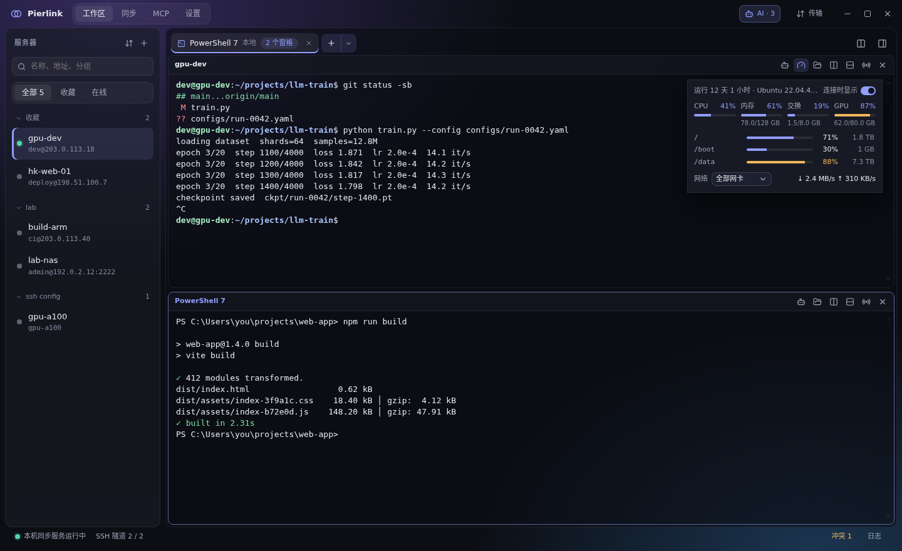
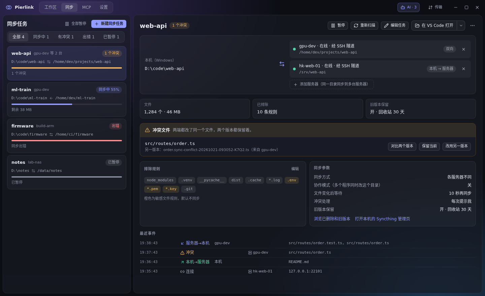
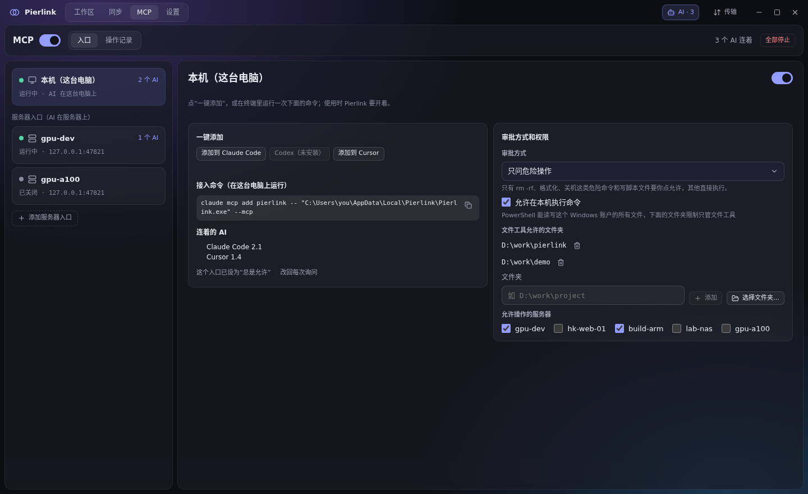
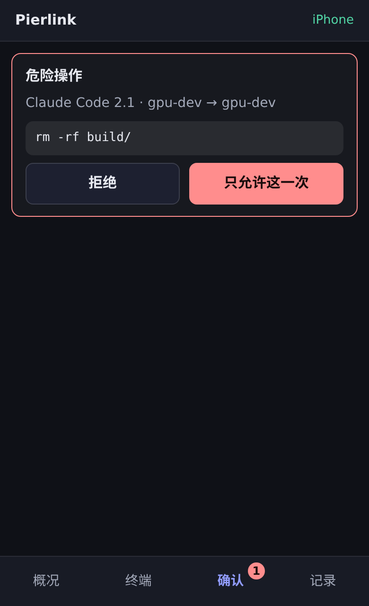

<div align="center">


# Pierlink

**Windows 上的多服务器远程开发工作台**

终端、文件同步、AI 接入，一个窗口管好所有服务器。

[English](README.en.md) · 简体中文

[](https://github.com/pierlink/Pierlink/releases/latest)
[](LICENSE)
[](#安装)

[下载](https://github.com/pierlink/Pierlink/releases/latest) · [功能](#功能) · [快速上手](#快速上手) · [常见问题](#常见问题) · [许可](#许可)

</div>



## 为什么用 Pierlink

- **一处登录，处处可用**：内置 SSH 登录一次（密码、验证码都行），终端、文件、端口转发、同步、概况全部共用，不用反复输密码。
- **本机写代码，服务器上跑**：服务器目录和 Windows 本地目录自动双向同步，用你习惯的编辑器改，改完服务器上马上就是新的。
- **AI 干活，你来把关**：Claude Code、Codex、Cursor 等 AI 助手可以操作你的终端和服务器；AI 跑在服务器上也能像装在 Windows 上一样改代码、编译运行。危险操作先问你；人不在电脑前，也能在手机上批准。

## 功能

### 终端
- 服务器和本机终端：多标签、分屏、拖动换位置；切换页面后终端保持运行
- 广播输入（一次发给多个窗格）、命令片段（支持变量）
- Shift+Enter 换行不执行（shell、Claude Code、Codex 里都能用）；选中文字时 Ctrl+C 复制，Ctrl+V 粘贴；可以打开“右键复制粘贴”
- Claude Code、vim 等复制的内容直接进本机剪贴板（在 tmux 里也行）；点终端里的链接用 Windows 的浏览器打开
- 从资源管理器把文件拖进本机终端，自动填上路径（PowerShell、命令提示符、WSL 各按自己的写法）
- 服务器概况常驻在终端右上角：CPU、内存、交换、GPU、各挂载点磁盘、网速

### 连接
- 内置 SSH（CentOS 7 这样的老服务器也能连）；也可以按 `~/.ssh/config` 用系统 OpenSSH 连接，并一键导入
- 端口转发：本地、远程、SOCKS 代理，断线后自动恢复
- 文件面板：浏览、上传、下载、重命名、删除、在线编辑文本文件；窗格之间拖动即可传文件

### 文件同步
- 基于 Syncthing，经 SSH 隧道传输：不开放任何端口，服务器上不需要 root
- 首次同步前预览；冲突时对比两个版本再选；删除和覆盖的文件进旧版本，可以找回
- 一个本地目录可以同时同步到多台服务器；可以直接在 VS Code 里打开



### AI 接入（MCP）
- **AI 跑在服务器上，像装在 Windows 上一样干活**：Windows 不用装 Claude Code，服务器上的 AI 就能读写、按行修改、搜索你允许的 Windows 文件夹，在 Windows 上编译、运行、开后台任务；文件的编码和换行原样保留（GBK、UTF-16、CRLF 都行），长时间的编译不会被中途掐断
- AI 能查到自己能在哪些文件夹干活、有哪些 shell、同步的服务器路径对应 Windows 哪里；怎么做由 AI 自己决定
- 可以把开着的终端交给 AI，随时收回
- 危险操作（如 `rm -rf`、强制推送）要你确认；审批方式可选；每一步都有操作记录
- 一键添加到 Claude Code / Codex / Cursor，服务器上的 Claude Code / Codex / Gemini CLI 也能一键接上；标题栏能看到 AI 刚做了什么和命令输出



### 服务器桌面（VNC）
- 在标签页里直接显示服务器的 VNC 桌面，能和终端分屏；经 SSH 连接，不开端口
- 自动找到服务器上已有的桌面（TigerVNC 等）；密码输一次可记住
- 服务器上没有桌面时一键新建：只有你能连，关掉标签后继续运行；缺 TigerVNC 时自动获取，不需要管理员权限
- 画质、缩放、远程分辨率跟随窗口或选预设、全屏、在独立窗口打开
- 和 Windows 之间直接用 Ctrl+C、Ctrl+V 复制粘贴；能把剪贴板里的文字（包括中文）直接输入到远程

### 手机连接


- 不在电脑前时，用手机浏览器回答 AI 的确认、查看服务器状态、在开着的终端里敲命令
- 经 Tailscale 或局域网连到你的电脑，不对公网开放，也没有 Pierlink 自己的中转服务
- 二维码配对，电脑上批准；每台手机单独授权、可改名，随时撤销
- iPhone、Android 都能用，不用装 App

<br clear="right">

### 其他
- 导出服务器给别人一键导入；换电脑时备份、迁移服务器和设置（不含同步任务）
- 托盘常驻，关闭窗口后同步继续；断网、睡眠后自动重连
- 自动更新；中文、英文界面

## 安装

1. 在 [Releases](https://github.com/pierlink/Pierlink/releases/latest) 下载 `Pierlink_<版本>_x64-setup.exe`。
2. 运行安装程序，选择安装语言（中文或英文），按提示完成。不需要管理员权限。
3. 有新版本时，窗口底部会提示，点一下即可更新。

**系统要求**

| | 要求 |
|---|---|
| 电脑 | Windows 10 / 11，64 位 |
| 服务器（终端、文件、端口转发） | 任何能用 SSH 登录的服务器 |
| 服务器（文件同步、服务器概况） | Linux，x86_64 或 ARM64 |
| 手机连接 | 手机和电脑在同一个 Tailscale 网络或局域网 |

## 快速上手

1. **添加服务器**：工作区服务器列表上方的“+”，填地址和用户名；已有 `~/.ssh/config` 的，用旁边的“导入 / 导出服务器”导入。
2. **打开终端**：双击服务器。第一次连接时核对服务器指纹。
3. **同步目录**：同步页 →“新建同步任务”，选本机目录和服务器目录，看过预览后开始。第一次会引导你在服务器上部署同步组件。
4. **接入 AI**：MCP 页打开总开关，点“添加到 Claude Code”（或 Codex、Cursor）。
5. **手机连接**（可选）：设置 → 手机，打开手机入口，用手机扫二维码配对。

## 常见问题

<details>
<summary><b>服务器上需要装什么吗？</b></summary>

不需要提前装。开终端、传文件只用 SSH；服务器概况通过已有的 SSH 连接读取系统信息，不在服务器上安装任何东西；第一次同步时，Pierlink 会把 Syncthing 部署到你的用户目录，不需要 root，也不开放端口。

</details>

<details>
<summary><b>AI 会不会乱执行危险命令？</b></summary>

MCP 默认关闭。打开后默认“只问危险操作”：删除文件、强制推送、关机这类命令要你点允许才执行，其他直接执行。也可以改成每次都问。AI 能操作哪些服务器、哪些文件夹，都由你勾选；所有操作都有记录，随时可以“全部停止”。

</details>

<details>
<summary><b>密码和私钥安全吗？</b></summary>

密码只在你选择保存时存进 Windows 凭据管理器；私钥不会离开你的电脑。导出的配置文件不含任何密码。

</details>

<details>
<summary><b>关掉窗口后同步还继续吗？</b></summary>

继续。关闭窗口默认缩到托盘，同步和终端在后台运行；完全退出 Pierlink 后本机同步才会停止，下次打开时接着同步。

</details>

<details>
<summary><b>支持 macOS 或 Linux 桌面吗？</b></summary>

目前只支持 Windows 10 / 11。服务器端支持各种 Linux。

</details>

## 隐私和安全

- 不收集任何使用数据。Pierlink 只会访问 GitHub 检查更新，以及你自己添加的服务器。
- 同步组件只监听本机，关闭了全局发现、中继和使用数据上报，数据只经 SSH 隧道传输。
- AI 接入和手机连接都需要你手动打开，权限可以随时收回。
- 发现安全问题请按 [SECURITY.md](SECURITY.md) 私下报告。

## 从源码构建

需要 Windows、[Node.js](https://nodejs.org/) 24、[Rust](https://rustup.rs/) stable 和 Visual Studio 的 C++ 生成工具（见 [Tauri 前置条件](https://tauri.app/start/prerequisites/)）：

```powershell
npm ci
node scripts/fetch-bundled.mjs   # 下载随包分发的 Syncthing 和 OpenSSH（固定版本，校验 SHA-256）
node scripts/gen-notices.mjs     # 生成第三方许可证汇总
npx tauri build                  # 安装程序在 target/release/bundle/nsis/
```

## 许可

Pierlink 按 [Functional Source License 1.1（Apache 2.0 未来许可）](LICENSE)（FSL-1.1-ALv2，[官网](https://fsl.software/)）发布：

- 个人和公司都可以免费使用、阅读和修改源码；
- 不能拿它做与 Pierlink 竞争的商业产品或服务；
- 每个版本发布满两年后，自动改为 Apache 2.0 许可。

[中文参考译文](LICENSE.zh-CN.md)仅供参考，以英文 [LICENSE](LICENSE) 为准。安装包附带的第三方组件按各自的许可证授权，见安装目录下的 `licenses` 文件夹。

## 反馈和贡献

- 问题和建议：[Issues](https://github.com/pierlink/Pierlink/issues)
- 想贡献代码：先看 [CONTRIBUTING.md](CONTRIBUTING.md)

## 致谢

Pierlink 建立在这些优秀的开源项目之上：[Tauri](https://github.com/tauri-apps/tauri)、[Syncthing](https://github.com/syncthing/syncthing)、[russh](https://github.com/Eugeny/russh)、[xterm.js](https://github.com/xtermjs/xterm.js)、[Win32-OpenSSH](https://github.com/PowerShell/Win32-OpenSSH)、[LibreSSL](https://github.com/libressl/portable)、[React](https://github.com/react/react)。
